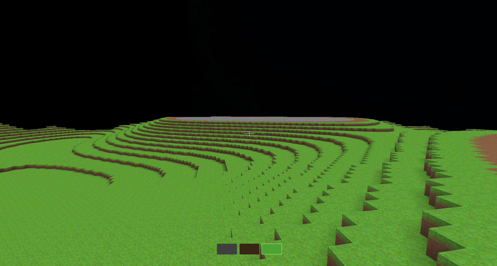

# Voxel Engine

A Minecraft-style voxel engine written from scratch in C++20 and OpenGL 3.3.



## Features

- **Procedural terrain**: OpenSimplex2 noise (via FastNoiseLite) generates a heightmap world.
- **Chunk streaming**: chunks load around the player as you move (12-chunk radius) and unload behind you. Loading and mesh rebuilds are spread across frames to avoid stutter.
- **Efficient meshing**: only faces next to air are generated, including across chunk boundaries.
- **Ambient occlusion**: per-vertex AO, with quad flipping to avoid diagonal seams.
- **Block interaction**: DDA voxel raycasting to break and place blocks, with a wireframe highlight on the targeted block.
- **Extras**: gradient skybox, texture atlas, crosshair and 3-slot hotbar.

## Quick start

You need a C++20 compiler, CMake 3.20 or newer, and the **GLFW** and **GLM** libraries. GLAD, stb_image and FastNoiseLite are already included in `vendor/`.

### Linux (Ubuntu/Debian)

```bash
sudo apt install build-essential cmake libglfw3-dev libglm-dev

git clone https://github.com/lukedev45/voxel_engine.git
cd voxel_engine
cmake -S . -B build -DCMAKE_BUILD_TYPE=Release
cmake --build build -j

./build/VoxelEngine
```

On Fedora, install the dependencies with `sudo dnf install gcc-c++ cmake glfw-devel glm-devel`. On Arch, use `sudo pacman -S base-devel cmake glfw glm`.

### Windows (vcpkg)

```powershell
vcpkg install glfw3 glm

git clone https://github.com/lukedev45/voxel_engine.git
cd voxel_engine
cmake -S . -B build -DCMAKE_TOOLCHAIN_FILE="$env:VCPKG_ROOT/scripts/buildsystems/vcpkg.cmake"
cmake --build build --config Release

.\build\Release\VoxelEngine.exe
```

> **Run it from the repository root.** Shaders and textures are loaded from the relative path `assets/`. If you start the program from inside `build/`, it will fail to find them and you'll see shader or texture errors.

## Controls

| Input | Action |
| --- | --- |
| Mouse | Look around |
| `W` `A` `S` `D` | Move |
| Left click | Break block |
| Right click | Place block |
| `1` `2` `3` / scroll wheel | Select block: stone, dirt, grass |
| `Esc` | Quit |

The cursor is captured while the window is open. Press `Esc` to exit.

## Troubleshooting

- **`Could not find a package configuration file provided by "glfw3"` (or `"glm"`)**: the library isn't installed, or CMake can't see it. On Windows, check that you passed the vcpkg toolchain file.
- **`Failed to load texture: assets/textures/atlas.png`** or shader compile errors: you're not running from the repository root (see the note above).
- **`Failed to create GLFW window`**: your GPU or driver doesn't support OpenGL 3.3 core. Update your graphics drivers.
- **macOS**: not currently supported. macOS needs a forward-compatible core context, which the window setup doesn't request yet.

## Project structure

```
src/
  main.cpp           Game loop, input, HUD, sky and highlight rendering
  World.*            Chunk map, streaming queues, voxel access, raycasting
  Chunk.*            Terrain generation, face-culled meshing, ambient occlusion
  Camera.*           First-person camera
  Shader.*           Shader loading and uniforms
  Window.*           GLFW window and OpenGL context
  TextureLoader.*    Texture atlas loading (stb_image)
  BlockData.h        Block types and atlas tile mapping
assets/
  shaders/           GLSL shaders (blocks, sky, highlight, HUD)
  textures/atlas.png Block texture atlas
vendor/              GLAD, stb_image, FastNoiseLite
```
